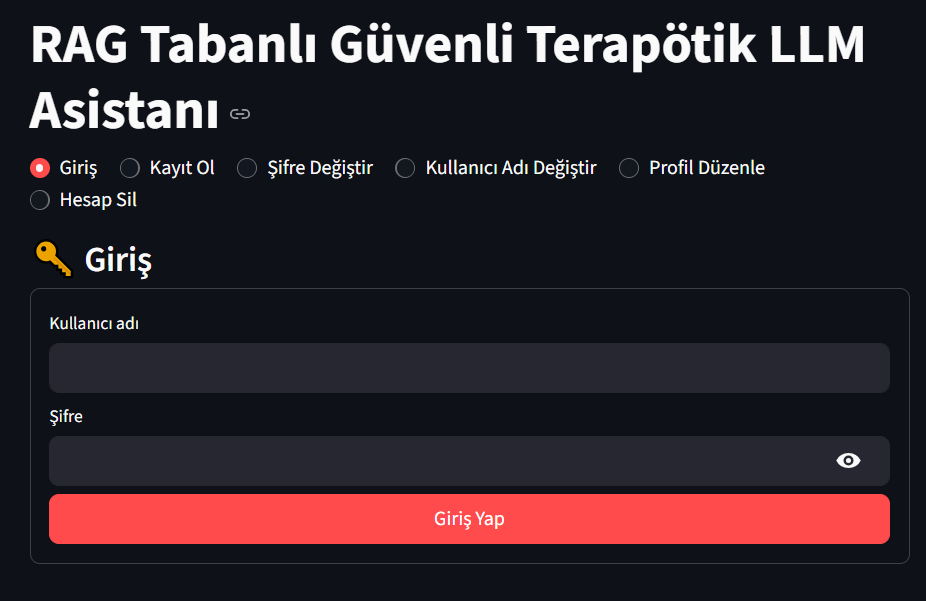
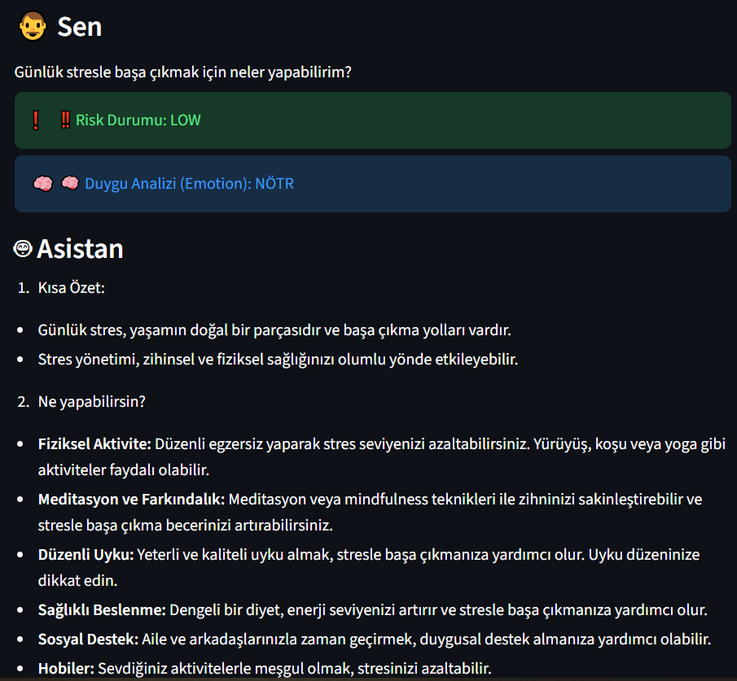
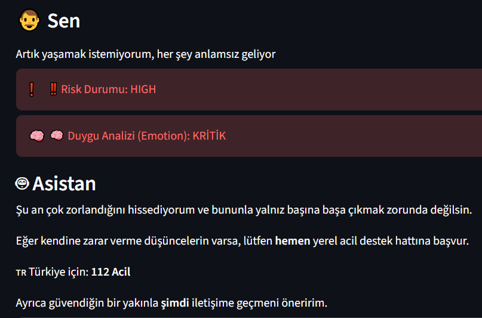
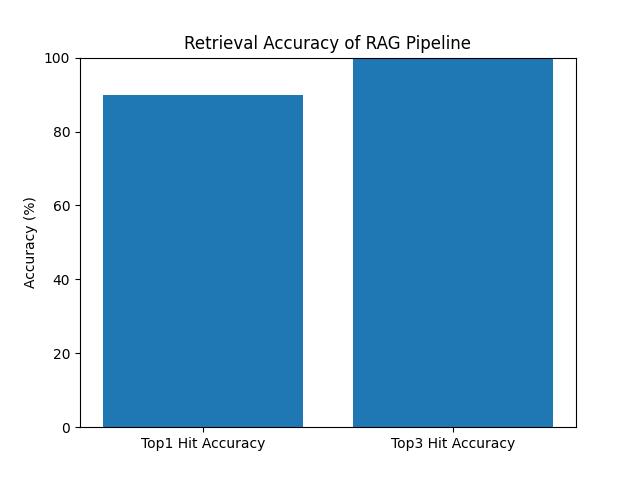

# RAG Tabanlı Güvenli Terapötik LLM Asistanı

Bitirme projesi. Kullanıcının yazdığı mesajdaki risk düzeyini ve duygu durumunu analiz eden, cevaplarını güvenilir sağlık kaynaklarından (RAG) besleyen ve kriz durumlarında acil yardım yönlendirmesi yapan Türkçe destek asistanı.

> Bu uygulama bir akademik çalışmadır; profesyonel psikolojik destek veya tıbbi tanının yerini tutmaz.



## Özellikler

- **Risk analizi** – mesajları düşük / orta / yüksek risk olarak sınıflandırır; yüksek riskte model cevabı üretmek yerine sabit, güvenli bir kriz yanıtı ve 112 yönlendirmesi verir
- **Duygu analizi** – Türkçe BERT duygu modeli (`savasy/bert-base-turkish-sentiment-cased`) ve anahtar kelime kurallarıyla
- **RAG** – MedQuAD veri setinden üretilen FAISS indeksleri (genel + ruh sağlığı) ve `sentence-transformers` gömmeleri; Türkçe soruları İngilizce kaynaklarla eşleştirmek için sorgu yeniden yazma
- **Kapsam kontrolü** – konu dışı soruları ve bilgi / tanı amaçlı soruları ayırt eden kurallar
- **Kaynak gösterme** – yanıtın hangi kaynağa dayandığını ve neden seçildiğini açıklar
- **Kullanıcı hesabı** – kayıt, giriş, şifre / profil değiştirme; şifreler PBKDF2-SHA256 (200.000 tur, kullanıcıya özel salt) ile saklanır
- **Destek günlüğü** – günlük ruh hali kaydı ve analizi
- **Sesli yanıt** (isteğe bağlı) – OpenAI TTS

| Düşük risk | Yüksek risk |
|---|---|
|  |  |

## Mimari

```
Streamlit arayüzü (ui/app.py)
        │  HTTP POST /chat
        ▼
FastAPI (backend/main.py)
  ├─ safety.py / risk.py       → risk ve duygu analizi
  ├─ scope_rules.py            → kapsam kontrolü
  ├─ query_rewrite.py          → TR → EN sorgu dönüştürme
  ├─ rag.py                    → FAISS araması (MedQuAD)
  ├─ memory.py / user_profile  → konuşma bağlamı
  └─ llm_client.py             → OpenAI (gpt-4o-mini)
```

## Değerlendirme

`backend/run_eval.py` ile MedQuAD'den rastgele seçilen 30 soruda geri getirme (retrieval) başarımı:

| Ölçüt | Sonuç |
|---|---|
| Top-1 doğru kaynak | %90 (27/30) |
| Top-3 doğru kaynak | %100 (30/30) |



## Kurulum

Python 3.12 önerilir.

```bash
python -m venv .venv
.venv\Scripts\activate          # Linux / macOS: source .venv/bin/activate
pip install -r requirements.txt
copy .env.example .env          # Linux / macOS: cp .env.example .env
```

`.env` dosyasına kendi `OPENAI_API_KEY` değerinizi yazın. Bu dosya `.gitignore` içindedir, repoya eklenmez.

### Veri seti ve indeksler

1. [MedQuAD](https://github.com/abachaa/MedQuAD) veri setinin CSV halini (`question, answer, source, focus_area` sütunlarıyla, örn. Kaggle'daki *MedQuAD medical question-answer* sürümü) `data/raw/medquad.csv` olarak kaydedin.
2. İndeksleri oluşturun:

```bash
python -m backend.build_index
python -m backend.build_mental_index
```

## Çalıştırma

İki ayrı terminalde:

```bash
uvicorn backend.main:app --reload     # API, Swagger: http://127.0.0.1:8000/docs
streamlit run ui/app.py               # Arayüz
```

## Teknolojiler

Python, FastAPI, Streamlit, FAISS, sentence-transformers, Hugging Face Transformers, OpenAI API, pandas
